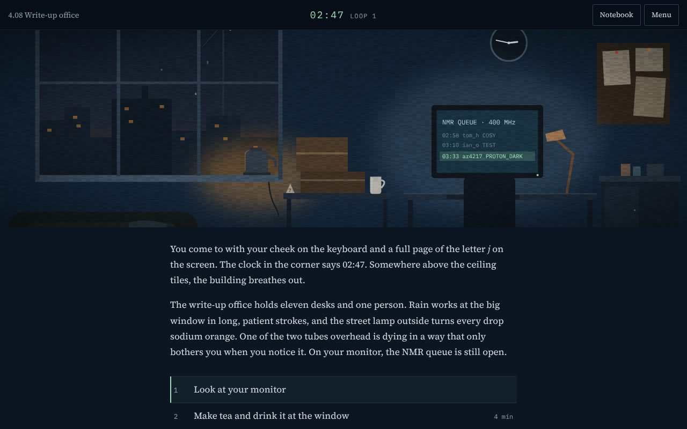
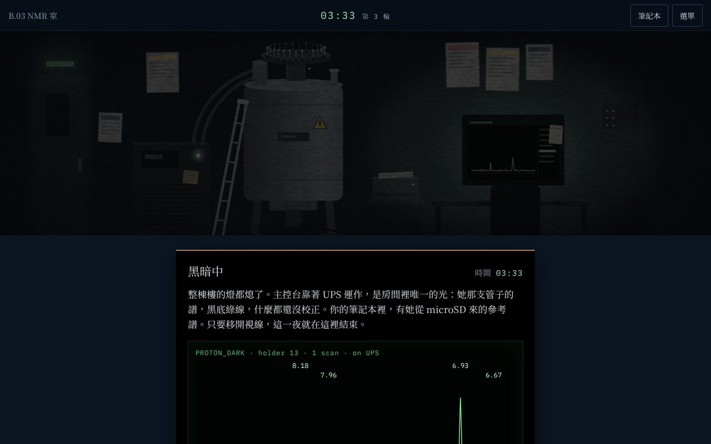

# Dark Reaction《暗反應》

> In photosynthesis, the dark reactions are the ones that keep running after the light is gone.
>
> 光合作用裡，暗反應是光熄滅之後，仍然繼續進行的那一段。

**Play in your browser: <https://angzeli.github.io/dark-reaction/>**
**線上遊玩：<https://angzeli.github.io/dark-reaction/>**

A time-loop mystery in a chemistry lab at 3 a.m., about what a result is worth. English and 繁體中文, written as two originals. No account, no download, nothing sent anywhere.

一個發生在凌晨三點化學實驗室裡的時間迴圈懸疑故事，關於一個結果到底值多少。英文與繁體中文各自原創書寫。不用註冊、不用下載，什麼都不會傳出去。

<p>


</p>

[English](#english) · [繁體中文](#繁體中文)

---

## English

### The story

It is 02:47 on a Monday in November, in a near-empty chemistry building in London. You are a final-year PhD researcher who came back for one last spectrum before a 09:00 deadline. The NMR queue lists a sample under your username at 03:33, forty-six minutes from now. You didn't book it. The glovebox oxygen reading is climbing, the rain has settled in for the night, and someone who worked on this floor before you has left traces everywhere.

At 03:33 the lights go out, and it is 02:47 again.

### Playing

- **Every action costs minutes;** the clock runs from 02:47 to 03:33. What you carry is gone at 02:47; what you know stays, in your notebook. Some pages in it are in your handwriting, and you don't remember writing them.
- **Three acts, eight rooms, ten puzzles** from real lab life: a TLC plate, a glovebox antechamber, the NMR console, a door-access log, a notebook cipher, a −80 °C freezer box, a Schlenk line, a cryocooler's chirp, three spectra side by side, and a peak in the dark. No chemistry knowledge needed, and each puzzle has three hints if you want them.
- **Six endings,** decided by what you do across every loop, not by one last button. An ending gallery keeps the ones you've found, and a new game carries faint pencil notes from your earlier ones.
- **About fifty minutes** for the shortest route to the true ending; most first playthroughs take longer, and the game saves as you go.

### Controls

| | Keyboard | Touch or mouse |
|---|---|---|
| Choose | number keys 1–9, or Tab and Enter | tap a choice |
| Finish the text at once | Space or Enter | tap the text |
| Notebook | N | Notebook |
| Menu, settings, saves | M or Esc | Menu |
| Puzzles | Tab between controls, arrow keys inside a group, Enter | tap |

### Settings and accessibility

Language (switch at any time without losing your place), text size, text speed, reduced motion, flicker off, high contrast, and sound (off until you turn it on). Every puzzle can be finished by keyboard alone and by touch alone; screen readers hear each puzzle's state as it changes. The checks run in CI on every change: axe on every screen in both languages and in high contrast, keyboard-only and touch-only solves of every puzzle, and motion and flicker off on every scene.

### Content note

A quiet, slightly frightening story about academic pressure, burnout, isolation, research misconduct and an unexplained disappearance. There is no gore and no self-harm. Some scenes use flickering light; you can turn flicker and motion off before you start, or at any time.

### Privacy

No analytics, no telemetry, no cookies, no login. The game makes no network requests once it has loaded (the production build's content security policy forbids them). Saves and settings stay in your browser's local storage, and you can export a save to a file.

### Running it yourself

You need Node 22.18 or later.

```sh
npm ci
npm run dev        # http://localhost:5173/dark-reaction/
npm run build      # subset fonts, typecheck, build to dist/
npm run preview    # serve dist/ at http://localhost:4173/dark-reaction/
```

Checks: `npm run typecheck`, `npm run lint`, `npm test` (Vitest), `npm run validate` (story graph, all six endings reachable, both languages in step, measured playtime), and `npm run e2e` (Playwright against the built site, including a bot that plays every ending in both languages). `CLAUDE.md` has the conventions and `docs/DESIGN.md` the design.

### How it's made

TypeScript and Vite with no UI framework. The story is data (`src/content/`), every line a key in two locale tables (`src/i18n/`), and the engine and puzzle rules are pure functions tested headlessly. Every illustration is SVG drawn in code; every sound is synthesised with Web Audio as you play. Fonts are self-hosted and subset at build time. Built with Claude Code.

### Credits and licence

What changed in each version is in [CHANGELOG.md](CHANGELOG.md).

By Angze Li. Code under the [MIT License](LICENSE). Story text, illustrations and sound design under [CC BY-NC-SA 4.0](LICENSE-CONTENT.md). Fonts (Source Serif 4, Noto Serif TC, IBM Plex Mono) under the SIL Open Font License 1.1; see [CREDITS.md](CREDITS.md).

---

## 繁體中文

### 故事

十一月的一個星期一，凌晨兩點四十七分，倫敦一棟幾乎沒人的化學系館。你是博班最後一年的研究生，為了早上九點的截止期限，回來跑最後一張譜。NMR 排程上掛著一支用你帳號送的樣品，時間是三點三十三分，四十六分鐘之後。你沒有排過它。手套箱的氧氣讀數一直往上爬，雨看起來會下一整夜，而在你之前待過這層樓的某個人，到處都留下了痕跡。

三點三十三分，燈熄了，然後又是兩點四十七分。

### 怎麼玩

- **每個行動都要花時間**：時鐘從 02:47 走到 03:33。身上帶的東西，到了 02:47 就沒了；知道的事情會留下來，記在你的筆記本裡。筆記本裡有幾頁是你的筆跡，你卻不記得自己寫過。
- **三幕、八個房間、十道謎題**，都取材自真實的實驗室日常：TLC 片、手套箱前艙、NMR 主控台、門禁紀錄、筆記本密碼、負八十冰箱、Schlenk line、冷凍機的啾聲、三張並排的譜，還有黑暗中的一根峰。不懂化學也能玩，每道謎題也都有三段提示可以看。
- **六種結局**，取決於你在所有迴圈裡做了什麼，而不是最後按了哪個按鈕。結局一覽會記住你找到的結局；開新遊戲時，筆記本邊上會留著你上一輪淡淡的鉛筆字。
- **走到真結局的最短路線大約五十分鐘**；第一次玩通常會更久。遊戲會隨時自動存檔。

### 操作

| | 鍵盤 | 觸控或滑鼠 |
|---|---|---|
| 選擇 | 數字鍵 1–9，或 Tab 加 Enter | 點選項 |
| 立刻顯示整段文字 | 空白鍵或 Enter | 點文字 |
| 筆記本 | N | 「筆記本」 |
| 選單、設定、存檔 | M 或 Esc | 「選單」 |
| 謎題 | Tab 在控制項間移動，同一組裡用方向鍵，Enter 確定 | 點選 |

### 設定與無障礙

語言（隨時切換，不會失去進度）、文字大小、文字速度、減少動態、關閉閃爍、高對比，以及聲音（預設關閉，要你打開才會響）。每道謎題都能只用鍵盤、或只用觸控完成；螢幕閱讀器會在謎題狀態改變時念出來。每次修改都會在 CI 裡檢查：兩種語言、高對比下每個畫面的 axe 檢測，每道謎題只用鍵盤和只用觸控的完整解題，以及每個場景在減少動態與關閉閃爍下的表現。

### 內容提醒

這是一個安靜、有點嚇人的故事，涉及學術壓力、過勞、孤獨、學術造假，以及一樁沒有解釋的失蹤。沒有血腥畫面，也沒有自傷情節。部分場景有燈光閃爍，開始前或任何時候都可以關掉閃爍和動態效果。

### 隱私

不追蹤、不回傳、沒有 cookie、不用登入。遊戲載入之後不會發出任何網路請求（正式版的內容安全政策直接禁止）。存檔和設定只留在你瀏覽器的本機儲存空間裡，也可以把存檔匯出成檔案。

### 自己跑起來

需要 Node 22.18 以上。

```sh
npm ci
npm run dev        # http://localhost:5173/dark-reaction/
npm run build      # 字型子集化、型別檢查、輸出到 dist/
npm run preview    # 在 http://localhost:4173/dark-reaction/ 提供 dist/
```

檢查：`npm run typecheck`、`npm run lint`、`npm test`（Vitest）、`npm run validate`（故事圖、六種結局都走得到、兩種語言同步、實測遊玩時間），以及 `npm run e2e`（對建置好的網站跑 Playwright，其中有一個用兩種語言把每個結局都玩過一遍的機器人）。慣例寫在 `CLAUDE.md`，設計寫在 `docs/DESIGN.md`。

### 怎麼做的

TypeScript 加 Vite，不用 UI 框架。故事是資料（`src/content/`），每一句話都是兩份語系表裡的一個鍵（`src/i18n/`），引擎和謎題規則都是不碰 DOM 的純函式，可以直接測試。每張插圖都是用程式畫的 SVG，每個聲音都是遊玩時用 Web Audio 即時合成的。字型自帶，建置時只保留用到的字。使用 Claude Code 製作。

### 致謝與授權

各版本的變更記錄在 [CHANGELOG.md](CHANGELOG.md)。

作者 Angze Li。程式碼採用 [MIT 授權](LICENSE)。故事文字、插圖與音效設計採用 [CC BY-NC-SA 4.0](LICENSE-CONTENT.md)。字型（Source Serif 4、Noto Serif TC、IBM Plex Mono）採用 SIL Open Font License 1.1，詳見 [CREDITS.md](CREDITS.md)。
